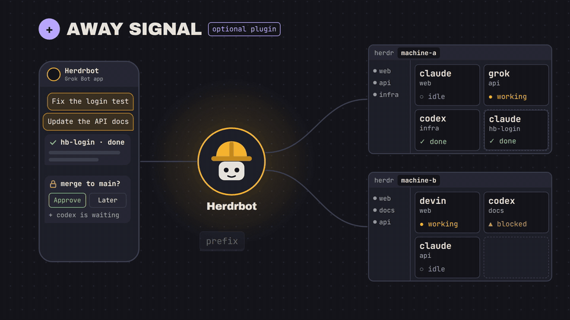

# away-signal

English | [한국어](README.ko.md) | [日本語](README.ja.md) | [繁體中文](README.zh-TW.md)



A [Herdr](https://herdr.dev) plugin for when you step away. A key turns away mode on or off. While it is on, the plugin POSTs to a webhook when an agent finishes a turn or waits for you, so an orchestrator watching your machines gets a signal instead of polling Herdr.

- **Away mode** is one flag file per machine. A key turns it on or off, POSTs the new state to the webhook and shows it in Herdr.
- **Agent signals** go out only while away mode is on: when an agent is waiting for you (`blocked`), or when it finishes a turn (`working`, then `done` or `idle`). The status must hold for 60 seconds and is read again from Herdr before it is sent, so a pause mid-turn is never reported. The same pane and status is not sent again within 10 minutes.
- **Dry run**: without a webhook URL (or with `dry_run = true`) nothing is sent; every signal is written to a log instead.

Needs Herdr 0.9.5 or newer, bash, curl and jq.

## Made for bots

Any service that takes a JSON POST can receive these signals, but the plugin was made for one job: giving bots an away signal. Chat bots and agent orchestrators, such as Grok Bot or dots, that look after your Herdr machines for you need to know two things: whether you are at the keyboard, and when an agent is done or stuck. With away-signal they get both pushed to them, instead of polling Herdr over SSH:

1. You press the away key as you leave. The bot learns you are away (`{"type":"away","on":true}`) and can take over: pass questions on to your phone, or carry on the work.
2. While you are away, each finished or waiting agent arrives as one signal, with the pane, the agent, its title and its folder, so the bot knows where to look.
3. You press the back key when you return, and the bot steps aside.

Each machine has its own away mode, and every signal names its machine, so a bot can look after each one separately: hand over the agents of a machine you left while you keep working on another. To keep several in step instead, the bot can create or remove [the flag file](#the-flag-file) over SSH.

## Install

```sh
herdr plugin install devicki/herdr-away-signal --ref v0.3.0 --yes
```

`--ref` pins a release. The config template is written on the first agent status change or key press, or when the Herdr server next starts.

## Settings

`away-signal.conf` in the plugin's config directory (`herdr plugin config-dir devicki.away-signal`, usually `~/.config/herdr/plugins/config/devicki.away-signal/`). The file holds a secret, so it is created readable by you only. [`away-signal.conf.example`](away-signal.conf.example) lists every setting.

| Key | Default | |
|---|---|---|
| `url` | none | the webhook; without it every signal is a dry run |
| `key` | none | sent as `Authorization: Bearer <key>` |
| `dry_run` | `false` | `true` logs signals without sending them |
| `machine` | short host name | how this machine names itself in every signal |
| `delay` | `60` | seconds a status must hold before it is sent |
| `repeat` | `600` | seconds before the same pane and status is sent again |

Every request is a POST with `Content-Type: application/json`:

```json
{"type":"away","on":true,"machine":"laptop"}
{"type":"agent","machine":"laptop","pane_id":"w1:p2","agent":"claude","status":"blocked","title":"fix the login test","cwd":"/home/me/shop"}
```

`status` is `blocked`, `done` (a turn that ended out of sight) or `idle` (one that ended in view). `title` is the pane's terminal title.

## Key binding

Plugins cannot bind keys, so add this to `~/.config/herdr/config.toml` and run `herdr server reload-config`:

```toml
[[keys.command]]
key = "prefix+a"
type = "plugin_action"
command = "devicki.away-signal.on"
description = "away: on"

[[keys.command]]
key = "prefix+shift+a"
type = "plugin_action"
command = "devicki.away-signal.off"
description = "away: off"
```

One key to leave and one to come back: pressing either again changes nothing, so a machine whose flag fell out of step is never flipped the wrong way. `devicki.away-signal.toggle` is there too if you prefer a single key. Both keys are free in Herdr 0.9.5's defaults; pick others if your own config already uses them.

## Sidebar mark

While away mode is on, the first workspace of each machine carries an `away` token (🌙 away): one row per machine, so you can see at a glance which machines are away. Tokens stay invisible until a sidebar row uses them; these are Herdr's default workspace rows with the token added to `~/.config/herdr/config.toml`:

```toml
[ui.sidebar.spaces]
rows = [
  ["state_icon", "workspace", "$away"],
  ["branch", "git_status"],
]
```

If you already customized `rows`, add `"$away"` to whichever row you like. When you attach to remote machines from a laptop, the laptop draws the sidebar, so this goes in the laptop's config. A flag changed over SSH shows at the next agent status change.

## The flag file

Away mode is on while this file exists:

```
~/.local/state/herdr/plugins/devicki.away-signal/away
```

Each machine and account has its own. To keep several in step, create or remove the file directly, for example over SSH: `touch <path>` or `rm -f <path>`. That works from any shell (fish too) and sends nothing. The plugin reads the flag on every status change and again before it sends.

From a shell:

```sh
bash away-signal.sh on | off | toggle   # same as the key: flag, webhook, Herdr notification
bash away-signal.sh status              # on or off
```

## Log

`~/.local/state/herdr/plugins/devicki.away-signal/away-signal.log` has every signal, marked `sent`, `FAILED` or `dry-run`, with curl's error when one fails. The key is never written to it. It keeps the last 500 to 1,000 lines.

## Testing

```sh
herdr plugin link .   # from a clone, instead of the install above
./test.sh
```

It starts an isolated Herdr (its own HOME, only this plugin linked) and a stand-in webhook on localhost, then checks the toggle action, the `pane.agent_status_changed` hook, the delay and repeat rules, the request headers, dry run and the config template. Your own Herdr server is not touched.

Checked end to end against a live bot on Herdr 0.9.5 (Linux): the away signal, a finished turn (`idle`) and an agent stopped at Claude Code's folder trust prompt (`blocked`) all arrived, the last two after the 60-second recheck.

By hand, with no webhook yet: link the plugin, press the key, and watch the log while an agent finishes a turn:

```sh
tail -f ~/.local/state/herdr/plugins/devicki.away-signal/away-signal.log
```

Set `delay = 5` while trying it so you do not wait a minute.

To release, bump `version` in `herdr-plugin.toml`, update the `--ref` in every README, commit, then `git tag -a vX.Y.Z -m vX.Y.Z && git push origin vX.Y.Z`.

## License

MIT
